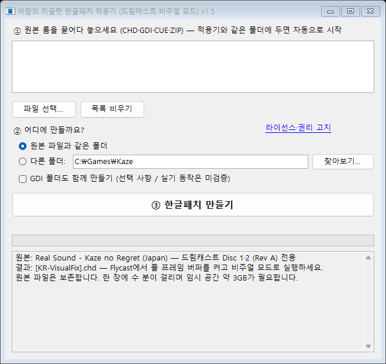
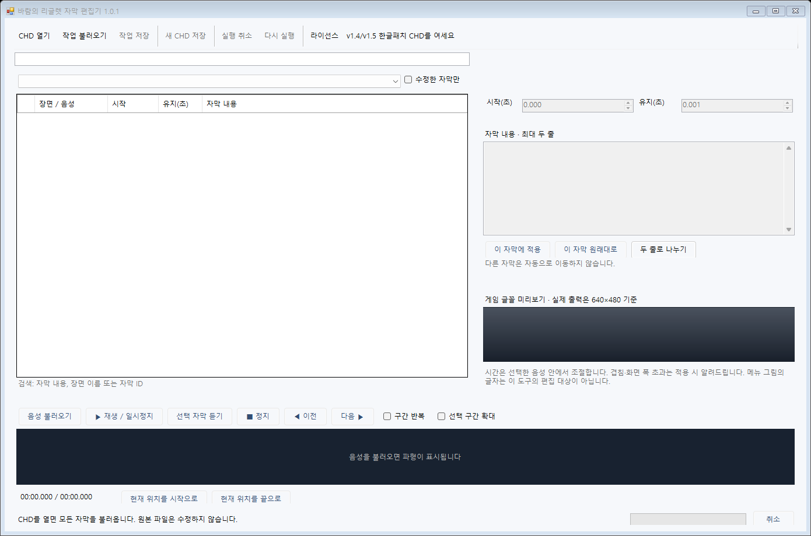

# 바람의 리글렛 — 드림캐스트 한글 자막 패치

**Real Sound ~風のリグレット~ · 일본판 Disc 1·2 / Rev A · v1.5**

무료로 공개하는 비공식 팬 번역입니다. 이용자가 별도로 보유한 원본 게임 이미지가 필요합니다. 게임 이미지와 BIOS는 제공하지 않습니다.

## 다운로드와 적용

### [Windows 간편 적용기 v1.5 다운로드](https://github.com/ayaneros-eng/kaze-no-regret-dreamcast-korean-patch/releases/download/v1.5.0/KazeNoRegret_DC_Korean_v1.5_Windows.zip)

**일반 이용자는 이 ZIP 하나만 받으면 됩니다.** Python이나 별도 패치 프로그램을 설치할 필요가 없습니다. GitHub 자동 생성 `Source code`는 일반 이용자용 적용기가 아닙니다.

1. ZIP 압축을 풉니다.
2. 본인이 준비한 **드림캐스트 일본판 Rev A 원본 CHD 두 장**을 적용기와 같은 폴더에 둡니다.
3. `KazeRegretDCKRPatcher.exe`를 실행합니다. 원본을 찾으면 5초 뒤 자동으로 시작합니다. 또는 창에 CHD를 끌어놓고 **한글패치 만들기**를 누릅니다.
4. 만들어진 **`[KR-VisualFix].chd`**를 Flycast로 실행합니다. 디스크 1부터 시작하세요.

원본을 수정하거나 기존 결과를 덮어쓰지 않습니다. 한 장씩 적용할 수도 있으며, 전체 플레이에는 두 장 모두 필요합니다. Windows 10/11 기준이고 디스크당 수 분, 임시 공간 약 3GB와 결과 저장 공간이 필요합니다. GDI 원본은 `.gdi`와 트랙 파일을 함께 둔 채 `.gdi`를 넣으세요. CUE/ZIP 입력도 지원합니다. 새턴판·초판·CDI 셀프부트 이미지는 지원하지 않습니다. GDI 출력 선택은 실기/ODE 동작 보장을 뜻하지 않습니다.

## Flycast 설정

검증 기준은 [Flycast 2.7 공식 배포판](https://github.com/flyinghead/flycast/releases/tag/v2.7)입니다.

| 항목 | 설정 |
|---|---|
| Full Framebuffer Emulation / 풀 프레임 버퍼 | **켜기** |
| 그래픽 API | **Vulkan** |
| 내부 해상도 | 기본 640×480 / 480p |
| Threaded Rendering | 켜기 |
| 게임 시작 모드 | **비주얼 모드** |

풀 프레임 버퍼를 끄면 원래 사진이 표시되지 않을 수 있습니다. 새 CHD를 **완전히 새로 부팅**하세요. 패치 전이나 다른 빌드의 세이브스테이트를 사용하지 마세요. 일반 VMU 세이브는 별도이며 보관해 두세요. 블랙스크린 모드와 다른 렌더러·실기·ODE는 미검증입니다.

차임이 울리면 Y/X/B 또는 위/왼쪽/오른쪽으로 선택지 음성을 듣고, 해당 음성이 나오는 동안 A 또는 L/R 트리거로 확정합니다.

## 자막 편집기

### [자막 편집기 1.0.1 Windows ZIP](https://github.com/ayaneros-eng/kaze-no-regret-dreamcast-korean-patch/releases/download/editor-v1.0.1/KazeSubtitleEditor_v1.0.1_Windows.zip) · [자세한 사용법](EDITOR.md)

패치된 CHD에서 음성을 들으며 자막 내용·시작시간·유지시간을 고치고 새 CHD로 저장합니다. 선택하지 않은 자막은 자동으로 이동하지 않습니다. v1.4와 v1.5의 게임 데이터는 같아 둘 다 읽을 수 있습니다.

## v1.5의 배포 구조와 검증

게임 내용·자막 타이밍·사진 출력 동작은 기존 v1.4와 같습니다. 이번 버전은 **배포 구조를 교체**한 것입니다. 원본 실행 코드와 UI 데이터는 이용자의 ROM에서 복사하고 변경분을 적용합니다. 새 자막 모듈·번역·글리프 외의 완성 게임 파일을 패치에 넣지 않습니다.

- KZRP2 원본 참조·XOR 차분 방식입니다. BPS/xdelta 도구에 넣는 파일이 아닙니다.
- 원본 트랙 SHA-256을 확인한 뒤 새 작업 사본을 만듭니다. 패치 무결성, 결과 트랙 SHA-256·CRC32, CHD 내부 무결성을 검사합니다.
- 독립 검사기로 두 디스크의 모든 변경 섹터와 나머지 원본 섹터를 대조했습니다. 원본 프로그램 691,232/692,224바이트는 모두 이용자 ROM을 참조합니다.
- 두 원본 CHD에 실제 적용하여 기존 검증본과 같은 최종 CHD SHA-256이 나오는지 검사합니다. 실제 측정 결과와 검증 범위는 [검증 보고서](distribution-verification.json)에 있습니다. 이번 배포 변경에서 전 분기를 다시 청취·플레이했다고 주장하지 않습니다.
- 자막 타이밍은 기존과 같으며 일부 어긋남이 남아 있습니다. 원하는 항목은 편집기로 조절할 수 있습니다.

원본 CHD SHA-256은 디스크 1 `50e1dcea319ab451b73055ccc6f721c861e69b0d71b58f30b7e443c57cf4a0d5`, 디스크 2 `4e888d39ed8ee4733b8924070c0ed172c7056934058e860d286cb2fa5519a808`입니다. CHD 압축이 다르면 전체 파일 해시는 달라도 되지만 내부 원본 트랙은 정확히 일치해야 합니다.

## 소스·라이선스·권리

- 적용기: `build_patcher.ps1`, 편집기: `editor/build.ps1`을 Windows PowerShell에서 실행합니다. Windows 기본 .NET Framework 컴파일러를 사용합니다.
- [패치 형식·재생성 방법](FORMAT.md), `build_recipe.py`, `verify_recipe.py`는 개발자용입니다. 원본/결과 트랙 경로는 로컬에서 지정하며 해당 트랙을 공개하지 마세요.
- [프로젝트 코드 MIT 라이선스](LICENSE), [게임·번역 권리 고지](RIGHTS.md), [외부 프로그램과 글리프 고지](THIRD_PARTY.md), [전체 고지](LICENSES.txt)를 확인하세요. 두 EXE에서도 라이선스 버튼으로 전문을 볼 수 있습니다.
- [SHA-256 목록](SHA256SUMS.txt), [외부 도구 출처 검증](license-provenance.json).

무료·차분 배포는 번역과 개작에 필요한 권리자의 허락을 대신하지 않습니다. 게임·사진·음성·원본 코드의 권리는 각 원 권리자에게 있습니다. MIT 허락은 직접 작성한 도구 코드 등에만 적용되며 게임·번역·게임에서 파생된 변경분에 대한 이용 허락이 아닙니다. 권리자의 공식 허락 또는 법률상 최종 합법 판정을 받았다는 뜻으로 공개하지 않습니다.

기존 BPS/적용기 배포와 게임 화면 이미지는 공개 배포에서 정리했습니다. 과거 브랜치·태그·릴리즈도 정리하지만 이미 받은 사본이나 GitHub의 캐시·미참조 객체까지 회수·영구 삭제되었다고 보증하지 않습니다. 예전 클론을 다시 푸시하지 말고 새로 복제하세요.
